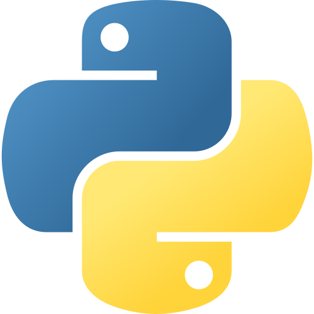
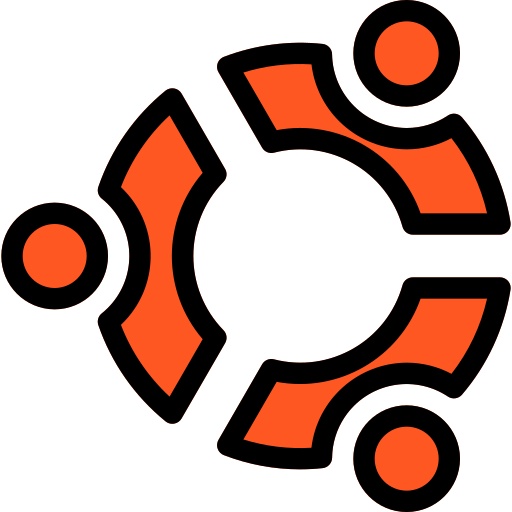
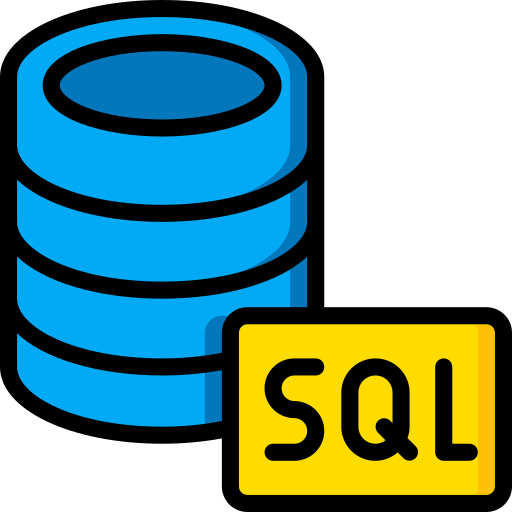
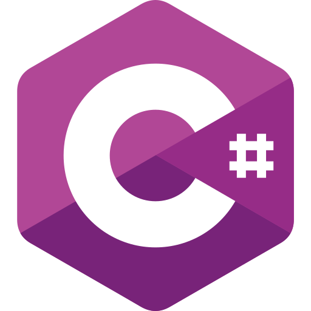

# Hi there, I'm Ali Muhammad👋

## Assistant Manager - Process Automations | AI & LLM Engineer | Full Stack Developer
--------------------------------------------------------
Hi, I'm Ali Muhammad Asad.

I am a **Computer Science Graduate from Habib University** with a passion for building intelligent systems and automating complex workflows. My journey has taken me from academic research to optimizing enterprise processes.

Currently, I work as an **Assistant Manager - Process Automations** at **Alkaram Studio**, where I leverage full-stack technologies and AI to streamline operations. Previously, I enhanced academic retrieval systems using Chatbots and Analysis tools as an MT at **Habib University (Office of Institutional Research)**.

I am deeply invested in **Agentic RAG**, **Machine Learning**, and **Cloud Native Development**, constantly pushing the boundaries of what automated systems can achieve.

Apart from work, I enjoy gaming (Minecraft, No Man's Sky, Hollow Knight and Silksong, Valorant, and Rocket League), music (Piano, Violin), and much more!     

<!-- 

 
   Visitor count:
    
 

 -->

 

  
 

 
📈 Stats

 
My Github Stats
<!--   -->

 

## 💼 Experience & Impact

**Alkaram Studio** | *Assistant Manager - Process Automations*
- Driving digital transformation by building full-stack web applications and automating workflows using.
- Implementing data analysis pipelines and optimizing business processes.

**Habib University** | *Management Trainee (OIR)*
- Lead the development of a multi-agent RAG Agent for academic data, including course and instructor evaluations, teacher profiles, course learning outcomes, and course grades - offering faster insights, and improved analytics for academic improvement.
- Designed and implemented the data architecture for the chatbot; MongoDB for structured storage of data, Atlas Cloud Vector Search for qualitative data indexing, and a custom-built RAG pipeline with intent-based tool selection for numerical, statistical, and qualitative analysis.
- Contributing to automation initiatives for departmental tasks across the university to improve efficiency.

---

### 🚀 Current Focus & Goals

- 🔭 Building scalable **Agentic RAG** systems and fine-tuning LLMs/DL models.
- 🌱 Deepening knowledge in **Cloud Native Development** , **DevOps**, and **MLOps**.
- 🥅 **Goals:** Mastering Cloud Architecture, and deploying production-grade AI agents.

## Connect With Me:

[][linkedin]
[][Gmail]
[][Outlook]
[][discord]
[][Facebook]
[][instagram]

 
 

## 🛠️ My Tech Stack

### 🤖 AI, LLMs & Data

   

### 🌐 Full Stack & Automation

 

   

### ☁️ Cloud & DevOps (Exploring)

<!--  -->

   

### 🛢️ Databases & Other

 
 

  <h3>Contribution<h3>
  

 
 

  <h3>Profile Views<h3>
  

<!--
**AliMuhammadAsad/AliMuhammadAsad** is a ✨ _special_ ✨ repository because its `README.md` (this file) appears on your GitHub profile.

Here are some ideas to get you started:

- 🔭 I’m currently working on ...
- 🌱 I’m currently learning ...
- 👯 I’m looking to collaborate on ...
- 🤔 I’m looking for help with ...
- 💬 Ask me about ...
- 📫 How to reach me: ...
- 😄 Pronouns: ...
- ⚡ Fun fact: ...
-->
<!--

  

-->

[Linkedin]:https://www.linkedin.com/in/ali-muhammad-asad/
[Instagram]:https://www.instagram.com/aliimuhammad73/
[facebook]:https://www.facebook.com/alimuhammad/
[discord]:https://discord.com/users/nightwing6973
[gmail]:mailto:alimuhammadasadlm10@gmail.com
[outlook]:mailto:aa07190@alumni.habib.edu.pk
