<div align="center">

<!-- Cyberpunk HUD Animated SVG Banner -->


<br/>

<!-- Holographic Gateway to Dedicated 3D Web Portal -->
<!-- <a href="https://AliMuhammadAsad.github.io">
  
</a> -->

<br/><br/>

<!-- Interactive HUD Shields / Telemetry Pills -->
<p align="center">
  <a href="https://www.linkedin.com/in/ali-muhammad-asad/"></a>
  <a href="mailto:alimuhammadasadlm10@gmail.com"></a>
  <a href="https://discord.com/users/nightwing6973"></a>
  <a href="https://ieeexplore.ieee.org/document/11318475"></a>
  <a href="https://orature-ai.github.io/ALIF-LLM/index.html"></a>
</p>

</div>

---

```yaml
┌──[ HUD // AGENT TELEMETRY ]────────────────────────────────────────────────────────┐
│ OPERATIVE      : Ali Muhammad Asad                                                 │
│ MISSION FOCUS  : Agentic RAG • Urdu LLM Architectures • GenAI • Process Automation │
│ CURRENT POST   : Data Associate @ Habib University (COO's Office)                  │
│ FORMER POSTS   : Asst. Manager Automations @ Alkaram • MT @ Habib University OIR   │
│ ALMA MATER     : B.Sc. Computer Science @ Habib University (CGPA: 3.71)            │
│ SELECT HONORS  : Stanford IHP '24 • ICPC Regional Top 10 • IEEE Author • 12x TA    │
│ STATUS BEACON  : 🟢 ALL SYSTEMS OPERATIONAL // ARCHITECTING AUTONOMOUS AGENTS      │
└───────────────────────────────────────────────────────────────────────────────────┘
```

---

## ⚡ Flagship Research Spotlight: ALIF (Urdu LLM)

<div align="center">
  <table>
    <tr>
      <td>
        <h3>🧠 ALIF: Urdu Generative Pre-Trained Large Language Model</h3>
        <p><b>Final Year Project (FYP) @ Habib University</b> &bull; <a href="https://orature-ai.github.io/ALIF-LLM/index.html"><b>Visit Project Hub &rarr;</b></a></p>
        <ul>
          <li><b>33 GB Pretraining Corpus:</b> Built robust web scrapers and high-throughput cleaning pipelines to curate the largest dedicated textual Urdu pretraining dataset.</li>
          <li><b>Custom Regex BPE Tokenizer:</b> Engineered a GPT-4-inspired regex Byte Pair Encoding tokenizer tailored for Urdu phonology, outperforming existing multi-lingual tokenizers across downstream tasks.</li>
          <li><b>Decoder Transformer Models:</b> Trained and evaluated <b>100M</b> and <b>1B</b> parameter Urdu LLMs, surpassing larger base models on Question Answering, Sentiment Analysis, and Grammar Error Correction.</li>
        </ul>
        <p>
          
          
          
          
        </p>
      </td>
    </tr>
  </table>
</div>

---

## 🔬 Research & Publications Deck

<details open>
<summary><b>[PUB_01] Pashto Poetry Attribution using Deep Learning Techniques &mdash; IEEE Xplore</b></summary>
<br>

* **Venue:** IEEE Published &bull; [Read Paper on IEEE Xplore &rarr;](https://ieeexplore.ieee.org/document/11318475)
* **Highlights:**
  * Curated and cleaned the **first-ever dataset on Pashto poetry**, containing **35,000+ couplets across 35 poets** in an ultra-low-resource setting.
  * Engineered a specialized NLP data augmentation protocol (random deletion, random swap) that boosted feature stability.
  * Benchmark evaluation across Classical ML, Bi-LSTM, and Transformers &mdash; **Random Forest achieved 85.25% accuracy**, with Bi-LSTM closely trailing.

```
[ METRICS ] :: ACCURACY: 85.25% | CORPUS: 35,000+ COUPLETS | STATUS: IEEE PUBLISHED
```
</details>

<details>
<summary><b>[RES_02] Multi-Author Style Detection Analysis using LLMs &mdash; PAN 2025</b></summary>
<br>

* Fine-tuned transformer foundation models (**BERT, RoBERTa, DeBERTa, Llama, and Gemma**) for the PAN 2025 Multi-Author Style Detection task.
* Achieved **~90% accuracy**, demonstrating superior multi-author boundary detection against benchmark iterations.

```
[ ARCHITECTURES ] :: DeBERTa | RoBERTa | Llama | Gemma | TOP ACCURACY: ~90%
```
</details>

<details>
<summary><b>[RES_03] Structured Learning on Bayesian Networks for CRISPR-Cas13 Systems</b></summary>
<br>

* Developed probabilistic graphical models using `pgmpy` to predict guide RNA efficiency for the CRISPR-Cas13 system.
* Implemented the **Hill Climbing algorithm** for structured DAG learning, modeling complex biological dependencies.
* [GitHub Repository &rarr;](https://github.com/AliMuhammadAsad/CRISPR_NET/)

```
[ MODEL ] :: Bayesian Network (DAG) | ALGORITHM: Hill Climbing | FRAMEWORK: pgmpy
```
</details>

<details>
<summary><b>[RES_04] Empirical Performance Study of Graph Database Engines</b></summary>
<br>

* Executed an independent empirical benchmarking study comparing **Neo4j, Memgraph, RedisGraph, and ApacheHugeGraph**.
* Employed the **LDBC Social Network Benchmark (SNB)** suite to evaluate throughput, latency, memory footprints, and ingest speed under deep graph traversal queries.
* [GitHub Repository &rarr;](https://github.com/AliMuhammadAsad/STRP2-GraphDB-Comparison)

```
[ BENCHMARK SUITE ] :: LDBC SNB | TARGETS: Neo4j vs Memgraph vs RedisGraph vs HugeGraph
```
</details>

---

## 💼 Enterprise & Applied AI Engineering

```
┌──[ INDUSTRY MISSIONS ]─────────────────────────────────────────────────────────────┐
│ 🏛️ HABIB UNIVERSITY (COO's Office) | Data Associate                                │
│    • Driving institution-wide operational intelligence, executive KPI dashboards,   │
│      and strategic resource planning using predictive analytics pipelines.        │
│                                                                                    │
│ 👗 ALKARAM STUDIO | Assistant Manager - Process Automations                        │
│    • Architected a production full-stack Generative AI system: an AI agent that    │
│      generates marketing imagery from text prompts & garment sketches, editing     │
│      poses, backgrounds, and styling with zero turnaround lag.                     │
│    • Streamlined high-throughput business workflows and enterprise data pipelines. │
│                                                                                    │
│ 🤖 HABIB UNIVERSITY (Office of Institutional Research) | Management Trainee       │
│    • Developed a Multi-Agent RAG Assistant for academic course & teacher metrics.  │
│    • Implemented hybrid data architecture: MongoDB for structured data, MongoDB    │
│      Atlas Vector Search for qualitative semantic retrieval, and intent routing.   │
└────────────────────────────────────────────────────────────────────────────────────┘
```

---

## 🛠️ The Cybernetic Arsenal

<div align="center">

### `[ NEURAL & AI SYSTEMS ]`
<p>
  
  
  
  
  
  
</p>

### `[ FULL STACK & INTERACTIVE ]`
<p>
  
  
  
  
  
  
</p>

### `[ GRAPH, VECTOR & RELATIONAL DATA ]`
<p>
  
  
  
  
</p>

### `[ SYSTEMS, ROBOTICS & INFRA ]`
<p>
  
  
  
  
  
  
</p>

</div>

---

## 🗂️ Engineering Projects Vault

| Project | Tech Stack | Highlights |
| :--- | :--- | :--- |
| **[Smart Walking Cane](https://github.com/AliMuhammadAsad/Smart-Walking-Cane-for-Indoor-Navigation-for-the-Visually-Impaired)** | `ROS`, `Gazebo`, `MATLAB`, `LiDAR`, `A*` | Simulated indoor navigation cane for the visually impaired equipped with LiDAR & camera obstacle avoidance. |
| **[Evolving L-Systems](https://github.com/AliMuhammadAsad/Evolving-L-Systems)** | `Python`, `Evolutionary Algorithms` | Evolved Lindenmayer System production rules via genetic operators to synthesize complex botanical fractal patterns. |
| **[COVID-19 Self Organizing Map](https://github.com/AliMuhammadAsad/Self-Organizing-Map)** | `Python`, `NumPy`, `SOM` | Unsupervised neural clustering on pandemic telemetry, visualizing global cluster topology. |
| **[Unix Memory Management Simulator](https://github.com/AliMuhammadAsad/Stack-and-Heap-Memory-Management)** | `C Language`, `UNIX CLI` | Simulated low-level stack and heap memory allocation, pointer dereferencing, and deallocation boundaries. |
| **[Customer Churn Intelligence](https://github.com/AliMuhammadAsad/10Pearls-Data-Science-Internship-Project)** | `PostgreSQL`, `Scikit-Learn`, `Flask` | End-to-end churn prediction pipeline with feature engineering, SQL storage, and REST API deployment. |

---

## 📜 The Wall of Honor & Academic Milestones

```
🏆 [STANFORD UNIVERSITY] Selected for Stanford International Honors Program 2024 (50% Merit Grant)
🥇 [ICPC GIKI FINALS]    Top 10 Regional Finalist in the International Collegiate Programming Contest
🎖️ [NSTC OLYMPIAD]       National Science Talent Contest (Math) — Selected for National Team Training Camp
⭐ [IAAC BRONZE]         Bronze Honor @ International Astronomy & Astrophysics Competition (Top 15% Globally)
🎓 [HABIB UNIVERSITY]   80% Merit-Based Scholarship recipient across 4-year Computer Science B.Sc.
```

### 🧑‍🏫 The 12x Teaching Assistantship Ledger @ Habib University
> *Trusted across 12 courses to teach core Computer Science fundamentals:*

`Algorithmic Problem Solving (PFun)` &bull; `Data Structures & Algorithms` &bull; `Discrete Mathematics (3x)` &bull; `Nature of Computation (Automata Theory)` &bull; `Algorithms: Design & Analysis` &bull; `Object Oriented Programming` &bull; `Data Structures II` &bull; `Graph Data Sciences` &bull; `Calculus II` &bull; `Competitive Programming`

---

## 📈 GitHub Telemetry

<div align="center">


<br/><br/>

<div align="center">
  
</div>

</div>

---

## 🎮 The "Offline Ali" Subroutines

When the terminal compiles and the models finish training, you'll find me on:

* 🕹️ **Gaming:** *Spiderman, Valorant, Marvel Rivals, Minecraft, No Mans's Sky, Outer Wilds, Rocket League, Hollow Knight & Silksong, Fortnite*
* 🎹 **Acoustic Frequencies:** *Piano, Violin*
<!-- * 🏓 **Sports:** *Table Tennis / Ping Pong* -->

---

<div align="center">

```
========================================================================================
[ CONNECTION TERMINATION ] :: REACH OUT VIA ALIMUHAMMADASADLM10@GMAIL.COM // PEACE OUT ✌️
========================================================================================
```

<a href="https://u8views.com/github/AliMuhammadAsad">
  
</a>

<!-- <br/>

**Ali Muhammad Asad &copy; 2026** &bull; [Explore the 3D Web Portal](https://AliMuhammadAsad.github.io)

</div> -->